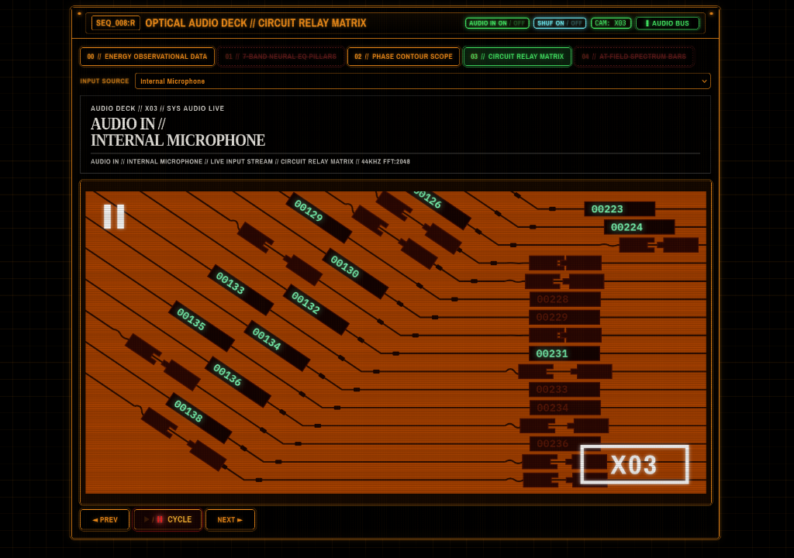
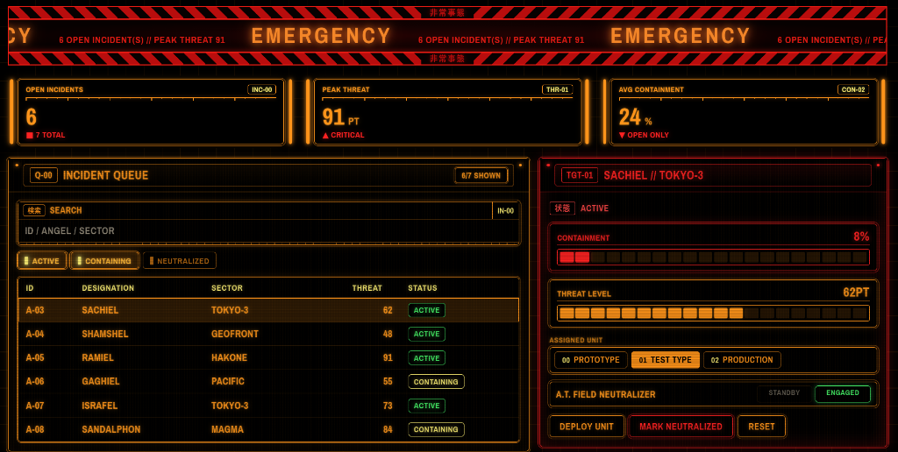

<div align="center">

```text
+------------------------------------------------------------------------------+
|  NERV // TOKYO-3 INTERFACE SYSTEM                                  [SYS:00]  |
|                                                                              |
|  #####  #   #   ###          #   #  ###    Svelte 5 . Web Components         |
|  #      #   #  #   #         #   #   #     Design Tokens . Audio FFT         |
|  ####   #   #  #####  #####  #   #   #     MAGI . Tactical HUDs              |
|  #       # #   #   #         #   #   #                                       |
|  #####    #    #   #          ###   ###    STATUS: ALL SYSTEMS NOMINAL       |
+------------------------------------------------------------------------------+
```

**Reusable Evangelion / NERV-inspired UI component library, CSS design tokens, live Web Audio FFT visualizers, and video-frame motif explorer.**

[](https://svelte.dev)
[](./svelte.config.js)
[](./src/lib/styles/tokens.css)
[](./wrangler.jsonc)

**[Live Demo](https://eva-ui.tallgeese.workers.dev/)**

</div>

---

## Screenshots

### `03 // AUDIO VISUALIZER` — Optical Audio Deck & Live Input



### `04 // COMMAND CONSOLE` — Incident Queue & Tactical Telemetry



---

## Agent-First Craftsmanship

`eva-ui` was built to be **immediately ergonomic for both humans and AI coding agents** — zero-config defaults, strict zero-indexed conventions (`00`–`07`), composable atomics, and optional deep configurability.

- **Core Library, Visualizers, Audio Deck, Explorer & Philosophies (`00`–`03`)**: Designed and iterated with **Gemini Hydrogen**, **Gemini Neon**, and **Gemini Argon** models.
- **Command Console (`04 // COMMAND CONSOLE`)**: Built **95% by Claude Sonnet 5.5 (Low)** in a single pass against the exported library surface, demonstrating how cleanly an agent can assemble a full tactical incident-response dashboard from `eva-ui` primitives.

---

## Showcase Routes (`00`–`04`)

| Index | Route | Module | Highlights |
| :--- | :--- | :--- | :--- |
| `00` | `/` | **UI Library** | Full catalog of NERV panels, MAGI consensus triads, telemetry meters, forms, modals, toasts, and CRT controls |
| `01` | `/explorer` | **Frame & Motif Explorer** | Inspects extracted video reference frames (`static/analysis/frames`) paired with auto-generated motif tokens |
| `02` | `/philosophies` | **Core Philosophies** | Interactive living spec for `PHIL-00` through `PHIL-07` |
| `03` | `/visualizer` | **Audio Visualizer** | Camcorder OSD housing 5 live FFT visualizers (`00`–`04`) with drag-to-reorder, middle-click skip/disable, shuffle mode, song title card, and fixed-bottom `EvaAudioController` transport |
| `04` | `/command` | **Command Console** | Live incident-response console with flashing `EvaAlertBanner`, sentiment-aware `EvaStatCard`, filterable `EvaDataTable`, `EvaBreadcrumb` unit selector, `EvaHexGrid` sector map, `EvaModal`, and `EvaTerminal` operations log |

---

## CRT Phosphor Themes

Switchable globally via `[data-eva-theme="..."]` in [`src/lib/styles/tokens.css`](./src/lib/styles/tokens.css):

| Theme | Attribute | Primary Phosphor | Accent | Character |
| :--- | :--- | :--- | :--- | :--- |
| **NERV** | `nerv` | `#ff941a` Amber | `#ff2222` Red | Classic NERV Command Console & CRT bloom |
| **EMERGENCY** | `emergency` | `#ff2222` Crimson | `#ff941a` Amber | Full-red Pattern Blue alert state |
| **MAGI CYAN** | `magi-cyan` | `#72f7ff` Cyan | `#ff941a` Amber | MAGI supercomputer diagnostic mode |
| **SYNC** | `sync` | `#46f76a` Phosphor Green | `#ff2222` Red | Harmonic / Entry Plug synchronization |
| **MONO** | `mono` | `#fff275` Phosphor Gold | `#ff2222` Red | High-contrast monochrome phosphor |

> Global CRT scanline & Trinitron aperture-grille overlays are controlled via `EvaCrtControl` (`off`, `scanlines`, `aperture`).

---

## Component Inventory

<details>
<summary><strong>00 // Atomic Building Blocks</strong> — frames, pills, scales, LEDs, HUD boxes</summary>

`EvaFrame` · `EvaCapsulePill` · `EvaHazardStrip` · `EvaRulerScale` · `EvaLedIndicator` · `EvaChamferBox` · `EvaBilingualHeader` · `EvaSplitReadout` · `EvaTriadGrid` · `EvaHudBox` · `EvaSeekBar` · `EvaSegmentDisplay` · `EvaStatusTag` · `EvaModeStrip` · `EvaTitleCard` · `EvaStampBadge` · `EvaSpinner`

</details>

<details>
<summary><strong>01 // Live Audio & Telemetry Visualizers</strong> — Web Audio FFT + high-dynamic-range curves</summary>

- `EvaAudioController` — Full transport (`PLAY/STOP`, `LOAD`, `LOOP`, `BAR/EP` title card, volume, seek bar, `AnalyserNode` export)
- `EvaEnergyVisualizer` — `SEQ_125:B` dual-trace harmonic energy & clipping waveform
- `EvaEqPillars` — `SEQ_009:R` 7-band neural EQ pillars
- `EvaPhaseScope` — `SEQ_010:R` Lissajous / phase contour scope
- `EvaCircuitVisualizer` — `SEQ_008:R` circuit relay matrix
- `EvaPatternMatrix` — `SPEC-02` A.T. Field spectrum bars
- `EvaWaveform` · `EvaClockTimer`

</details>

<details>
<summary><strong>02 // MAGI & Tactical HUD</strong> — consensus voting, camcorder OSD, sector hex maps</summary>

- `EvaMagiPanel` · `EvaMagiNode` · `EvaMagiResolution` — 3-node Melchior / Balthasar / Casper voting triad
- `EvaHudOverlay` — Camcorder OSD (`REC`, `X00`–`X04`, `◄ PREV` / `CYCLE` / `NEXT ►`, `disabledIndices`, `shuffle`, interactive slot)
- `EvaHexGrid` — Interactive tactical sector hex grid (`idle` / `active` / `alert` / `nominal` + `selectedId`)
- `EvaAlertBanner` — Flashing `EMERGENCY` marquee with mirrored chevron hazard strips
- `EvaNervStatusWall` · `EvaPatternBlue` · `EvaReticle` · `EvaTerminal` · `EvaBootTerminal`

</details>

<details>
<summary><strong>03 // Application & Form Controls</strong> — tables, filters, inputs, overlays</summary>

`EvaPanel` · `EvaDataTable` · `EvaTabs` · `EvaBreadcrumb` · `EvaStatCard` · `EvaProgressBar` · `EvaCheckbox` · `EvaRadioGroup` · `EvaToggle` · `EvaSelect` · `EvaInput` · `EvaTextarea` · `EvaComboBox` · `EvaMultiSelect` · `EvaDatePicker` · `EvaStepper` · `EvaFilterChips` · `EvaModal` · `EvaToast` · `EvaAccordion` · `EvaPagination` · `EvaTooltip` · `EvaBentoMenu` · `EvaActionMenu` · `EvaSidebar` · `EvaLinkList` · `EvaAvatar` · `EvaIcon` · `EvaCommentThread` · `EvaCarousel` · `EvaCrtControl` · `EvaTransportButton`

</details>

---

## Core Philosophies (`PHIL-00`–`PHIL-07`)

Documented in [`AGENTS.md`](./AGENTS.md) and showcased live on `/philosophies`:

- `PHIL-00` **Composable Atomics & Component Reuse First**
- `PHIL-01` **Sequence-Accurate Visual Fidelity & `:B` / `:R` Attribution**
- `PHIL-02` **Authentic Rest & Zero-Signal Baselines**
- `PHIL-03` **High-Dynamic-Range Audio Reactivity & Freedom**
- `PHIL-04` **Overflow Motion, Accessibility & Showcase Organization**
- `PHIL-05` **Optional Deep Component Configurability**
- `PHIL-06` **Static Interactor Placement & Internal Highlighting**
- `PHIL-07` **Zero-Indexed & Programmatic Library Ergonomics**

---

## Quick Start

```bash
# Install dependencies
npm install

# Start dev server (http://localhost:8732)
npm run dev

# Type-check Svelte + TypeScript
npm run check

# Build reusable library package (src/lib -> dist)
npm run package

# Build static production site (build/)
npm run build
```

### Install in Another Project

Install directly from GitHub (`dist/` is prebuilt in the repo):

```bash
npm install github:ICtallgeeseXC/eva-ui-csstokens-svelte
```

### Using in Any Framework (Web Components, CSS Tokens & Svelte 5)

`eva-ui` is **framework-agnostic** — it works in **React, Vue, Angular, Solid, Astro, vanilla HTML/JS, and Svelte 5**:

1. **Native Web Components (`<eva-*>`)**: Every component compiles with `customElement: true` and `shadow: 'none'`, registering standard custom elements when imported (`<eva-panel>`, `<eva-stat-card>`, `<eva-progress-bar>`, `<eva-alert-banner>`, `<eva-hex-grid>`, etc.) while inheriting global `[data-eva-theme]` CRT tokens directly from the DOM.
2. **Pure CSS Tokens & Primitives**: `eva-ui/tokens.css` and `eva-ui/base.css` require **zero JS** and expose all `--eva-*` variables plus utility classes (`.eva-root`, `.eva-grid-bg`, `.eva-btn`, `.eva-btn-danger`, `.eva-badge`, `.eva-display`, `.eva-num`).

#### React / Vue / Vanilla HTML (Custom Elements + CSS)

```ts
// Register <eva-*> custom elements & load CRT tokens
import 'eva-ui/tokens.css';
import 'eva-ui/base.css';
import 'eva-ui';
```

```html
<div class="eva-root eva-grid-bg" data-eva-theme="nerv">
	<eva-alert-banner severity="emergency" headline="EMERGENCY" subtext="PATTERN BLUE DETECTED"></eva-alert-banner>
	<eva-stat-card label="PEAK THREAT" value="91" unit="PT" delta="CRITICAL" trend="up" sentiment="negative"></eva-stat-card>
	<eva-progress-bar label="THREAT LEVEL" value="91" danger-mode="high" danger-threshold="70" unit="PT"></eva-progress-bar>
	<button class="eva-btn">DEPLOY UNIT</button>
</div>
```

#### Svelte 5

```svelte
<script lang="ts">
	import 'eva-ui/tokens.css';
	import 'eva-ui/base.css';
	import { EvaPanel, EvaStatCard, EvaProgressBar } from 'eva-ui';
</script>

<div class="eva-root eva-grid-bg" data-eva-theme="nerv">
	<EvaPanel title="MAGI TELEMETRY" code="M-00">
		<EvaStatCard label="PEAK THREAT" value={91} unit="PT" delta="CRITICAL" trend="up" sentiment="negative" />
		<EvaProgressBar label="THREAT LEVEL" value={91} dangerMode="high" dangerThreshold={70} unit="PT" />
	</EvaPanel>
</div>
```

---

## Cloudflare Workers Deployment (`wrangler`)

Static site output is pre-configured with `@sveltejs/adapter-static` (`build/`) and [`wrangler.jsonc`](./wrangler.jsonc):

```bash
npm run deploy
```

This runs `npm run build && wrangler deploy` and publishes the static assets to the `eva-ui` Worker on your Cloudflare account.

---

<div align="center">

`NERV // TOKYO-3 INTERFACE SYSTEM — PATTERN VERIFIED`

</div>
